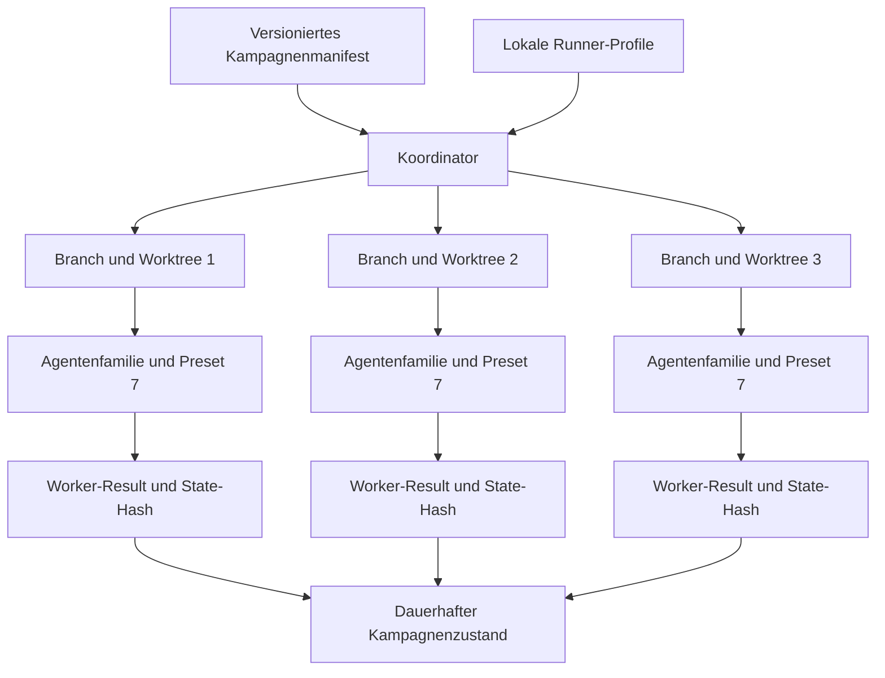

# Manifest und Runner-Profile / Manifest and Runner Profiles

## Optionales Intake-Review in Schema 1.2 / Optional intake review in schema 1.2

```json
"intakeReview": {
  "required": true,
  "resultPath": "specs/campaign/intake-review-result.json"
}
```

Bei aktiver Pflicht muss das Ergebnis vor der Worktree-Erstellung aktuell
sein. Jedes eindeutige Intake wird einmal semantisch geprüft; jeder Worker
erhält trotzdem eine eigene Applicability-Zeile. Review und Manifest müssen
DAG-Kanten und Ausnahmen mit Autor, Grund, Datum, Ablauf und Workern abgleichen.
Ein Campaign-Review benötigt eine gebundene Anfrage; der installierte
Intake-Review-Validator prüft das vollständige Ergebnis vor jedem Start und Resume.

When required, the result must be current before worktree creation. Review
each unique intake once, retain one applicability row per worker, reproduce the
manifest DAG, and separately govern operator exceptions. Resume revalidates
the stored result hash.
A campaign review needs a bound request; the installed intake-review validator
checks the complete result before every start and resume.

Vor jedem Worker-Start werden die wirksamen `featureInput`-Bytes und die
Autonomous-Preset-Version im tatsächlichen Worktree erneut geprüft. Auch ein
Worktree aus einem älteren Vorgänger-Commit muss dieselben Gates erfüllen.

Before each worker starts, the effective `featureInput` bytes and Autonomous
preset version are checked again in its actual worktree. A worktree based on
an older predecessor commit must pass the same gates.

Jeder Worker-Lauf erhält eine neue, zufällige `attemptId` und einen eigenen
Ergebnisordner, der als einziger zusätzlicher Schreibpfad an den Runner geht.
Ein explizites Ergebnis muss genau diese ID enthalten;
ein Ergebnis eines früheren Resume-Versuchs wird abgewiesen.

Each worker launch receives a fresh random `attemptId` and its own result
directory, the only additional writable path given to its runner. An explicit
result must carry that exact ID, so a previous Resume
result cannot be replayed.

Bei aktivem Autonomous-Preset-Gate muss jedes erfolgreiche Worker-Ergebnis
einen vollständig validierten `autonomous-run-state.json` im eigenen Worktree
mit passendem Hash, Run-ID, Branch, Delivery-Modus und abgeschlossenem Status
belegen. Vor einem Merge wird dieser Nachweis erneut geprüft.

When the Autonomous preset gate is active, every successful worker result
must bind a fully validated `autonomous-run-state.json` inside its worktree
to the claimed hash, run ID, branch, delivery mode, and completed status.
The coordinator checks that evidence again before merging.

Das Autonomous-Preset-Gate ist für operative Kampagnen verpflichtend. Das
Manifest kann es nicht deaktivieren; nur isolierte Test-Fixtures mit einem
separat gesetzten Testwurzel-Marker und dem mitgelieferten Fixture-Runner
dürfen die Abhängigkeit überspringen. Status und Stop bleiben lesbar.

The Autonomous preset gate is mandatory for operational campaigns. A manifest
cannot disable it; only isolated test fixtures with a separate test-root
marker and the bundled fixture runner may skip the dependency. Status and
Stop remain available.

[Handbuch / Manual](README.md) | [Lebenszyklus / Lifecycle](lifecycle-and-operations.md)

## Kampagnenarchitektur / Campaign architecture



**Textalternative DE:** Das versionierte Manifest beschreibt die Kampagne,
waehrend lokale Runner-Profile ausfuehrbare Bindungen liefern. Der Koordinator
erstellt isolierte Branches und Worktrees und startet dort Agenten mit Preset
7. Worker liefern Resultat und Hash ihres autoritativen States. Preset 8
schreibt daraus den dauerhaften Kampagnenzustand.

**Text alternative EN:** The versioned manifest describes the campaign while
local runner profiles provide executable bindings. The coordinator creates
isolated branches and worktrees and runs Preset 7 agents there. Workers return
a result plus the hash of their authoritative state. Preset 8 records durable
campaign state from those contracts.

## Deutsch

### Manifest

Das Manifest ist der gepruefte Kampagnenvertrag. Wichtige Felder:

| Feld | Bedeutung |
|---|---|
| `schemaVersion` | Kampagnenvertrag `1.0` oder `1.1` |
| `campaignId` | Stabile UUID |
| `topology` | Eine der vier Topologien |
| `deliveryMode` | `LocalImplementation`, `PublishPR` oder `MergeAndSync` |
| `publicationProfile` | Bei `PublishPR` ein rein lesendes Provider-Profil |
| `maxConcurrency` | Ganzzahl `1..3` |
| `runnerProfile` | Kampagnen-Fallback |
| `routingRole` | Stabile Standardrolle fuer Worker |
| `fallbackPolicy` | `fail-closed` fuer verbindliche lokale Bindungen |
| `requireAutonomousPreset` | Fuer reale Kampagnen immer `true` |
| `workers` | IDs, Repositories, Basen, Branches, Inputs und Abhaengigkeiten |
| `consolidation` | All-Ready, Reihenfolge, Auswahl und Merge-Profil |
| `postMergeActions` | Deklarierte idempotente Closeout-Aktionen |

Der gespeicherte Manifest-SHA-256 bindet Resume und Status an genau den
akzeptierten Vertrag. Drift wird nicht still uebernommen.
`PublishPR` verlangt ein explizites Worker-Ergebnis mit PR-URL und einen
lesenden Provider-Preflight fuer die offene PR, den exakten Head und die
kanonische Repository-/Branch-Identitaet. Ein reiner Runner-Exit reicht nicht.
Vor dem Kampagnenabschluss wird jede PR erneut geprüft. Ein vorübergehender
Providerfehler führt zu `NeedsRevalidation`; `Resume` prüft die vorhandene
Ergebnisevidence erneut, ohne den Worker noch einmal auszuführen.
Pausierte PublishPR-Läufe aus älteren Versionen ohne eigenen Ergebnisordner und
Ergebnis-Hash können nicht sicher übernommen werden; dafür ist ein neuer
Kampagnenlauf mit der aktuellen Vorlage erforderlich.

### Runner-Konfiguration

Runner-Profile bleiben lokal. Ein Profil enthaelt:

- `agentFamily`,
- `routingRole`,
- bei `fail-closed` ein ausdrueckliches `model`,
- bei `fail-closed` ein ausdrueckliches `reasoningEffort`,
- `executable`,
- einen read-only `preflight`,
- ein Argument-Array mit Platzhaltern.

Argumente werden direkt ohne Shell-Evaluation gestartet. Keine Secrets,
Environment-Werte oder Tokens gehoeren in Manifest, Status oder versionierte
Runner-Beispiele.

### Kampagnen- und Worker-Profil

`campaign.runnerProfile` ist der Fallback. Ein Worker darf ein eigenes
`runnerProfile` setzen. Dadurch kann eine Kampagne verschiedene
Agentenfamilien verwenden. `worker.routingRole` darf die Kampagnenrolle
praezisieren. Das gewaehlte Profil muss dieselbe stabile Rolle deklarieren.
Fehlende oder mehrdeutige Profile blockieren den Preflight.

Bei `fallbackPolicy: fail-closed` sind `model`, `reasoningEffort` und ein
erfolgreicher read-only Modell-Preflight verbindlich. Fehlt einer dieser Werte
oder scheitert der Preflight, wird der Worker `Blocked`, ohne einen
Arbeitsprozess zu starten. In aelteren nicht-strikten Manifesten bleiben Modell
und Reasoning optionale Statusmetadaten; fremde Agentenkonfiguration wird nie
erraten.

### Unterstuetzte Beispiel-Familien

Das Beispieltemplate zeigt Bindungen fuer Codex, Claude Code, GitHub Copilot
CLI, Google Antigravity, OpenCode und Junie. Es schreibt kein Modell vor und
erteilt keine pauschale Netzwerk- oder Schreibberechtigung.

### Lokaler Runtime-Bereich

`RuntimeRoot` enthaelt Worktrees, Locks, Logs und Prozessresultate. Dieser
Bereich bleibt ausserhalb versionierter Feature-Artefakte. Der normale Checkout
wird weder gewechselt noch zurueckgesetzt.
Der operative Campaign-State liegt standardmaessig direkt im `RuntimeRoot`.
Ein expliziter `-State`-Pfad muss dort liegen; `RuntimeRoot` darf nicht in einem
Worker-Repository liegen. Vorherige manifestnahe Checkpoints sind nur lesbare
Altbelege und benoetigen einen neuen Lauf fuer sichere Fortsetzung.
Vor Uebernahme vorhandener Worker werden Ergebnis-Hash, Versuch, Worktree-
Registrierung, Branch, HEAD und Autonomous-State erneut geprueft. Erfolgreiche
Post-Merge-Aktionen benoetigen einen unveraenderten Beleg im `RuntimeRoot`, der
Aktion, Profil, Repository, Merge-Commit und Exitcode bindet.
Runner-Logs werden direkt in Dateien gestreamt. Je Stream gelten 16 MiB und
vier Stunden Laufzeit; Profilbefehle haben 4 MiB je Stream und fünf Minuten.

Der Provider-Preflight muss die kanonische Head- und Zielrepository-Identitaet,
beide Branches und die PR-Nummer liefern. Der Head muss zum `origin` des
Worker-Repositories und zum deklarierten Worker-Branch passen. Fuer ein
anderes Zielrepository setzt der Worker `prBaseRepository`; fuer abweichende
direkte Ziel-Branches `prBaseRef`. Ein GitHub-Merge-Profil mit `gh` verwendet
die gepruefte PR-Nummer mit `--repo {prBaseRepository}` und
`--match-head-commit {headSha}`.

## English

### Manifest

The manifest is the reviewed campaign contract. It records schema, stable
campaign UUID, topology, delivery mode, concurrency, campaign runner fallback,
the required Preset 7 gate, workers, consolidation, and post-merge actions.

The persisted manifest SHA-256 binds status and resume to the accepted
contract. Drift is never adopted silently.
`PublishPR` requires an explicit worker result with a PR URL and a read-only
provider preflight for the open PR, exact head, and canonical repository and
branch identities. Runner exit alone does not complete publication.
Every PR is checked again before campaign completion. A temporary provider
failure yields `NeedsRevalidation`; `Resume` rechecks the existing result
evidence without rerunning the worker.
Paused PublishPR runs from older versions without per-worker result directories
and result hashes cannot be safely adopted; start a new campaign with the
current template.

### Runner configuration

Runner profiles stay local. A profile contains `agentFamily`, `routingRole`,
model, reasoning effort, an executable, a read-only preflight, and an argument
array with placeholders. Arguments execute directly without shell evaluation.

Do not put secrets, environment values, or tokens in manifests, status, or
versioned runner examples.

### Campaign and worker profiles

`campaign.runnerProfile` is the fallback. A worker may select another profile,
allowing mixed agent families in one campaign. A worker role may refine the
campaign role, and the selected profile must declare that same stable role.
Missing or ambiguous profiles fail preflight.

With `fallbackPolicy: fail-closed`, model, reasoning effort, and a successful
read-only model preflight are mandatory. Missing values or a failed preflight
block the worker before its process starts. Legacy non-strict manifests retain
optional status metadata and never guess another agent's configuration.

### Runtime boundary

`RuntimeRoot` contains worktrees, locks, logs, and process results outside
tracked feature artifacts. The normal checkout is never switched or reset.
Operational campaign state defaults directly under `RuntimeRoot`. An explicit
`-State` path must be there, and `RuntimeRoot` must be outside every worker
repository. Earlier manifest-local checkpoints are read-only historical
evidence and require a new run for safe continuation.
Before reusing a worker, the coordinator rechecks its result hash, attempt,
registered worktree, branch, HEAD, and Autonomous state. Successful post-merge
actions require an unchanged receipt under `RuntimeRoot` binding the action,
profile, repository, merge commit, and exit code.
Runner logs stream directly to files, capped at 16 MiB per stream and four
hours. Profile commands are capped at 4 MiB per stream and five minutes.

Provider preflight must return canonical head and target repository identities,
both branches, and the PR number. The head must match the worker repository's
`origin` and declared branch. Workers set `prBaseRepository` for a different
target repository and `prBaseRef` for a different direct target branch. A
GitHub merge profile using `gh` uses the verified PR number with
`--repo {prBaseRepository}` and `--match-head-commit {headSha}`.
